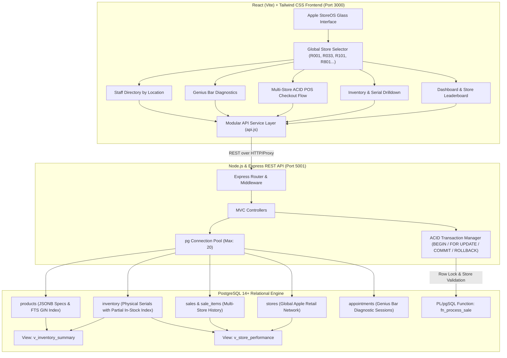

# Apple StoreOS — Production-Ready Store Management System
### Advanced DBMS Capstone Project & Real-World Enterprise Architecture

A complete, enterprise-grade Apple Store Management System designed and built from the database up. Modeled after actual **Apple Retail Store Network & Hardware Logistics datasets** (spanning global flagship stores like *Apple Fifth Avenue R001*, *Apple Regent Street R033*, *Apple Union Square R101*, and *Apple BKC R801*).

Featuring multi-store relational partitioning, strict ACID transactional integrity for Point of Sale (POS) operations, PostgreSQL Full-Text Search (FTS), partial indexing, a modular Express REST API with connection pooling, and an Apple-inspired minimalist React + Tailwind CSS dashboard with a live multi-store switcher.

---

## 🏛️ System Architecture



---

## 🌍 Real-World Apple Retail Dataset & Optimizations

### 1. Global Retail Network (`stores` Table)
Modeled directly on Apple's international retail footprint:
- **R001**: Apple Fifth Avenue (*New York, USA*) — Flagship Glass Cube (Tax: 8.875%)
- **R079**: Apple SoHo (*New York, USA*) — Historic Post Office Flagship (Tax: 8.875%)
- **R101**: Apple Union Square (*San Francisco, USA*) — California Flagship (Tax: 8.625%)
- **R033**: Apple Regent Street (*London, UK*) — European Flagship (VAT: 20.00%)
- **R138**: Apple Ginza (*Tokyo, Japan*) — First International Flagship (Tax: 10.00%)
- **R268**: Apple Champs-Élysées (*Paris, France*) — Haussmannian Flagship (VAT: 20.00%)
- **R488**: Apple Marina Bay Sands (*Singapore*) — Floating Sphere Flagship (GST: 9.00%)
- **R801**: Apple BKC (*Mumbai, India*) — Flagship Jio World Drive (GST: 18.00%)
- **R802**: Apple Saket (*New Delhi, India*) — Select CITYWALK (GST: 18.00%)

### 2. Comprehensive Modern Product Catalog
- **iPhones**: iPhone 16 Pro Max, iPhone 16 Pro, iPhone 16, iPhone 16 Plus
- **Macs**: MacBook Pro 16" (M4 Pro), MacBook Pro 14" (M4), MacBook Air 15" (M3), Mac mini (M4 Pro)
- **iPads**: iPad Pro 13" (M4 OLED Tandem), iPad Air 11" (M2)
- **Wearables**: Apple Watch Ultra 2 (49mm Titanium), Apple Watch Series 10
- **Spatial Computing**: Apple Vision Pro (Dual-chip M2 + R1, Micro-OLED 4K per eye)
- **Audio & Displays**: AirPods Pro 2 (USB-C), AirPods Max, Apple Studio Display 27" 5K

### 3. Database Performance Optimizations

#### A. Partial Index for In-Stock Units
```sql
CREATE INDEX idx_inventory_in_stock ON inventory(product_id, store_id) 
WHERE status = 'In Stock';
```
> **Impact**: In an enterprise database with millions of sold units over time, scanning the entire `inventory` table during checkout causes severe I/O bottlenecks. This partial index indexes **only sellable stock**, keeping index tree size small and POS lookups sub-millisecond.

#### B. Full-Text Search (FTS) with GIN Index
```sql
CREATE INDEX idx_products_fts ON products 
USING gin(to_tsvector('english', name || ' ' || specs::text));
```
> **Impact**: Powers lightning-fast keyword searches across both the product name and deep nested JSONB hardware specifications (e.g., searching `"Tandem OLED"`, `"Thunderbolt 5"`, or `"A18 Pro"`).

#### C. Cross-Store Performance View (`v_store_performance`)
```sql
CREATE OR REPLACE VIEW v_store_performance AS
SELECT 
    st.store_id,
    st.store_code,
    st.name AS store_name,
    st.city,
    st.country,
    st.flagship,
    st.tax_rate,
    COALESCE(inv.total_inventory_units, 0) AS total_inventory_units,
    COALESCE(inv.in_stock_units, 0) AS in_stock_units,
    COALESCE(sal.total_sales_count, 0) AS total_sales_count,
    COALESCE(sal.total_revenue, 0.00) AS total_revenue,
    COALESCE(apt.active_repairs, 0) AS active_repairs
FROM stores st
LEFT JOIN (SELECT store_id, COUNT(*) AS total_inventory_units, COUNT(CASE WHEN status = 'In Stock' THEN 1 END) AS in_stock_units FROM inventory GROUP BY store_id) inv ON st.store_id = inv.store_id
LEFT JOIN (SELECT store_id, COUNT(*) AS total_sales_count, ROUND(SUM(total_amount), 2) AS total_revenue FROM sales GROUP BY store_id) sal ON st.store_id = sal.store_id
LEFT JOIN (SELECT store_id, COUNT(*) AS active_repairs FROM appointments WHERE status IN ('Scheduled', 'In Progress', 'Awaiting Parts') GROUP BY store_id) apt ON st.store_id = apt.store_id;
```

#### D. Multi-Store Stored Procedure (`fn_process_sale`)
Enforces store-scoped locking, verifies the device is physically present at the selling store, computes jurisdiction-specific sales tax, updates inventory, and commits atomically.

---

## ⚡ REST API Endpoints

| Method | Endpoint | Description |
|---|---|---|
| `GET` | `/api/health` | PostgreSQL pool health check & server status |
| `GET` | `/api/stores` | Real-world Apple Retail Stores directory |
| `GET` | `/api/stores/performance` | Queries the `v_store_performance` benchmark view |
| `GET` | `/api/dashboard/stats?store_id=` | Store or global telemetry & activity feed |
| `GET` | `/api/products?search=&store_id=` | FTS-enabled catalog with store stock counts |
| `GET` | `/api/products/:id` | Product details with mapped serial numbers |
| `GET` | `/api/inventory?store_id=&status=` | Serialized inventory filtered by store & status |
| `GET` | `/api/inventory/by-product/:id?store_id=` | Physical serial numbers for drill-down modal |
| `POST` | `/api/inventory` | Intake new serial unit into a store |
| `PUT` | `/api/inventory/:serial/status` | Update unit status (`In Stock`, `In Repair`, etc.) |
| `POST` | `/api/sales/checkout` | **Multi-store ACID POS checkout transaction** |
| `GET` | `/api/sales?store_id=` | Sales history & receipts |
| `GET` | `/api/appointments?store_id=` | Genius Bar appointment schedule & diagnostics |
| `POST` | `/api/appointments` | Book Genius Bar repair session |
| `PUT` | `/api/appointments/:id` | Advance repair diagnostic lifecycle |
| `GET` | `/api/employees?store_id=` | Staff directory by store and role |
| `GET` | `/api/customers` | Customer lookup by name, email, or Apple ID |

---

## 🚀 Running the Project

### Option A: Unified Full-Stack Run (Single Process)
Run both the frontend and backend together on a single port (`http://localhost:5001`):
```bash
# 1. Install dependencies & build frontend
npm install
npm run build

# 2. Start unified server
npm start
# App is available at http://localhost:5001 (serves frontend SPA & all /api endpoints)
```

### Option B: Development Mode (Hot Reloading)
```bash
# Terminal 1 - Backend API (Port 5001)
npm run dev:backend

# Terminal 2 - Frontend Vite Dev Server (Port 5173 with proxy to backend)
npm run dev:frontend
```

---

## ☁️ Single-Deployment Guide (No Separate Frontend/Backend Needed)

The application is pre-configured for **unified full-stack deployment** on either **Render** or **Vercel** with zero separate frontend and backend deployments.

### 🟣 Deploying to Render (Recommended for Long-Running Web Services)

You can deploy the entire app and a PostgreSQL database in one shot using Render Blueprints or a single Web Service:

#### Method 1: Render Blueprint (Infrastructure-as-Code via `render.yaml`)
1. Push this repository to GitHub.
2. In [Render Dashboard](https://dashboard.render.com), click **New +** -> **Blueprint**.
3. Connect your repository. Render will automatically read `render.yaml`, provision a free PostgreSQL database (`apple-store-db`), build the frontend, and start the unified Node server.
4. Click **Apply**.

#### Method 2: Manual Web Service on Render
1. In Render Dashboard, click **New +** -> **Web Service**.
2. Connect your repository.
3. Configure settings:
   - **Environment**: `Node`
   - **Build Command**: `npm run build`
   - **Start Command**: `npm start`
4. Add Environment Variables:
   - `DATABASE_URL`: Your PostgreSQL connection string (from Render Postgres, Neon, Supabase, or AWS RDS).
   - `NODE_ENV`: `production`
5. Click **Deploy Web Service**.

---

### ▲ Deploying to Vercel (Serverless Full-Stack)

The repository includes a ready-to-use `vercel.json` and serverless bridge (`api/index.js`):

1. Push this repository to GitHub.
2. In [Vercel Dashboard](https://vercel.com), click **Add New...** -> **Project**.
3. Import your repository (keep the Root Directory as `./`).
4. Vercel automatically detects the build configuration:
   - **Build Command**: `npm run build`
   - **Output Directory**: `frontend/dist`
5. Under **Environment Variables**, add:
   - `DATABASE_URL`: Your remote PostgreSQL connection string (e.g. from Neon, Supabase, or Railway).
   - `DB_SSL`: `true` (default for cloud databases).
6. Click **Deploy**. Vercel will serve the frontend from its global CDN edge network and handle all `/api/*` routes via the Express serverless function (`api/index.js`).

---

## 🎓 Capstone Presentation & Defense Highlights
1. **Physical Unit Serialization**: Rather than treating stock as a simple integer counter, units are tracked by 12-character primary keys (`serial_number`) matching Apple manufacturing formats.
2. **ACID Transaction Isolation**: Uses pessimistic locking (`FOR UPDATE OF i`) to eliminate race conditions, preventing double-sell conflicts across concurrent physical store terminals.
3. **Multi-Store Architectural Partitioning**: Simulates enterprise ERP mechanics where each store maintains its own inventory, staff, tax rates, and Genius Bar workflows.
4. **PostgreSQL Full-Text Search (FTS)**: Native GIN indexing on `tsvector` enables fast search over unstructured JSONB specs without external search engines.
