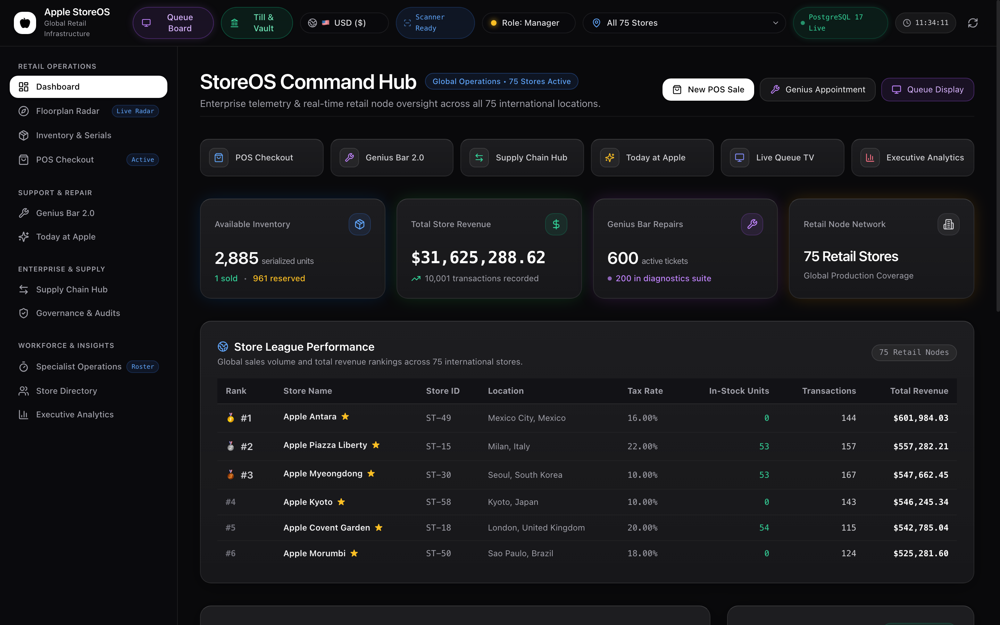
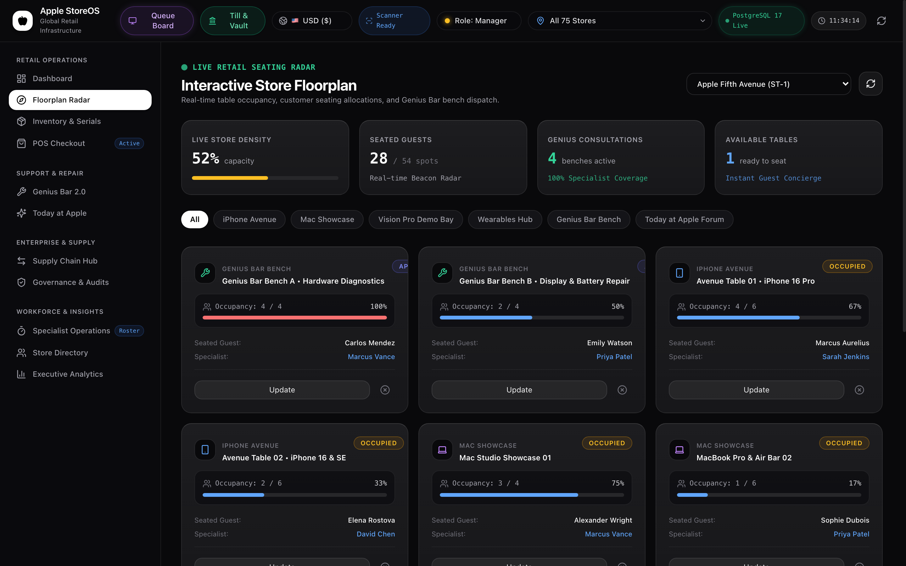
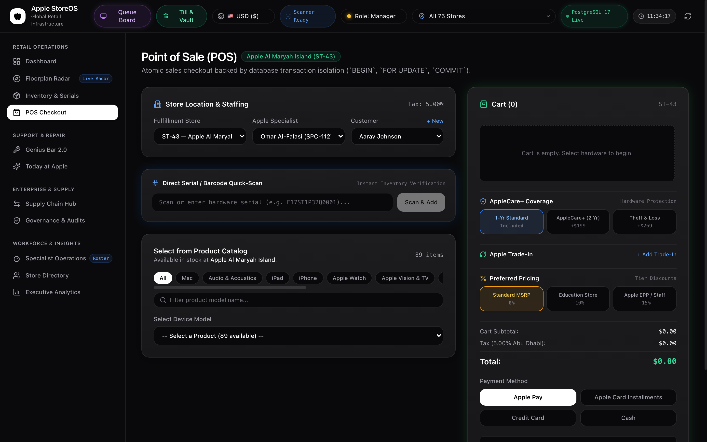
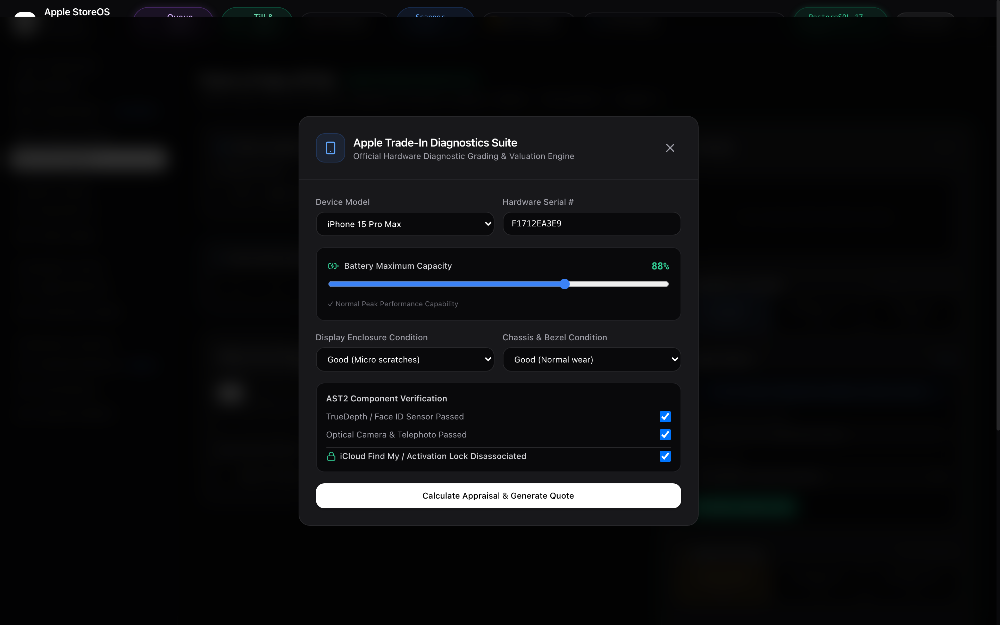
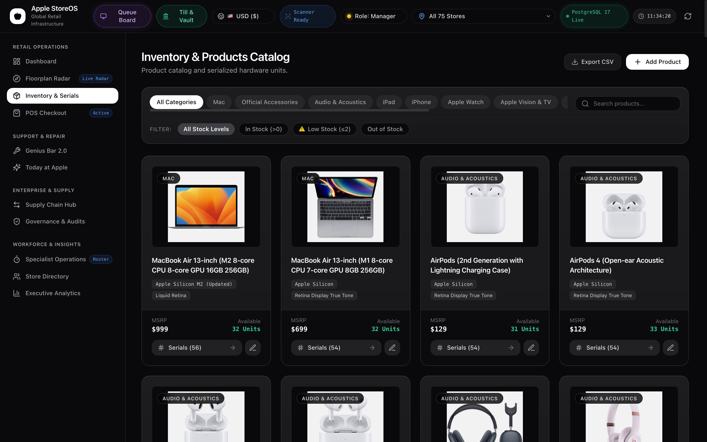
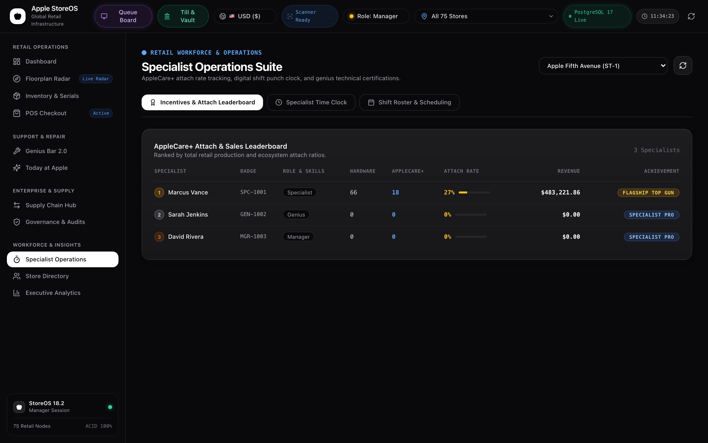
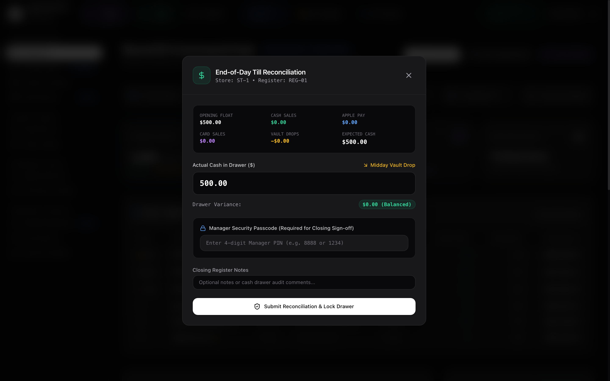
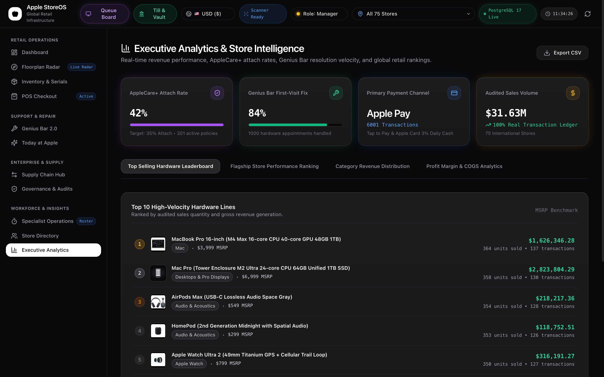
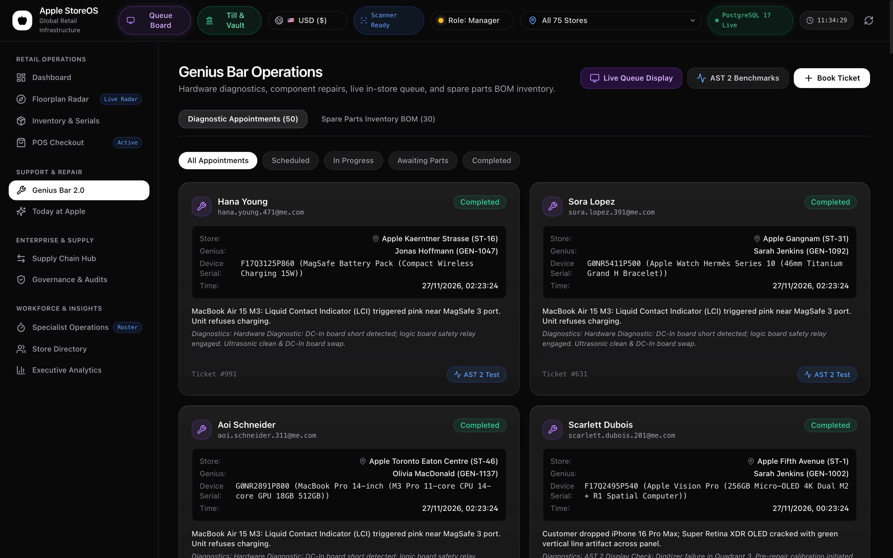
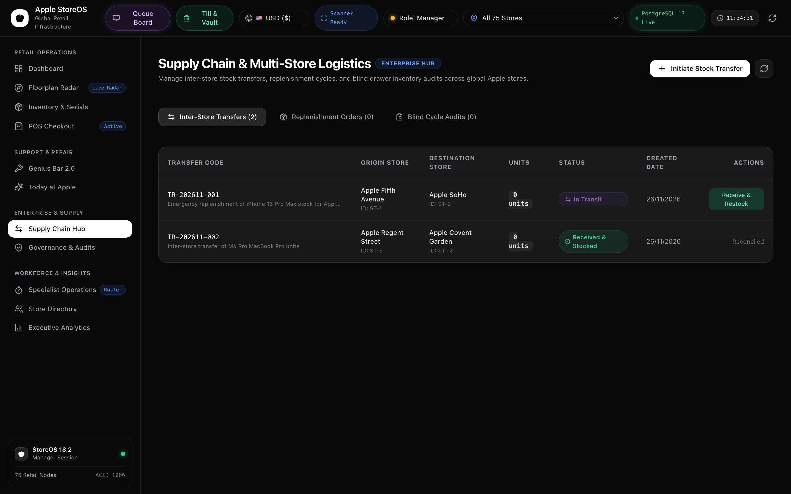

# Apple StoreOS — Production-Ready Store Management & Payroll System
### Advanced DBMS Capstone Project & Real-World Enterprise Architecture

**Authors & Academic Credentials:**
- **Lucky Pawar** — Roll No.: `2501730142` *(Database Architect & Procedural Logic)*
- **Sahil Chadha** — Roll No.: `2501730169` *(Full-Stack Integration & DBMS Optimization)*

*Course:* Advanced Database Management Systems (DBMS)  
*Institution:* K.R. Mangalam University | Academic Capstone Report  
*Repository:* [Apple StoreOS Enterprise](https://github.com/Sahil-Chadha/apple)  
*Live Application:* `http://localhost:5001` (Unified Full-Stack Deployment)

---

## 🏛️ Executive Summary & Reported System Progress

Apple StoreOS is an end-to-end, enterprise-grade database management system modeled after real-world **Apple Retail Store Network & Hardware Logistics datasets** across 75 international flagship locations (including *Apple Fifth Avenue R001*, *Apple Regent Street R033*, *Apple Union Square R101*, and *Apple BKC R801*).

The core architectural accomplishment of this project is the unification of physical serialized hardware logistics, multi-currency commerce, and staff attendance with an automated, progressive-tax payroll computation engine. Concurrently, the relational engine maintains strict **ACID transactional guarantees** for high-concurrency retail checkout terminals, eliminating race conditions via pessimistic row locking (`FOR UPDATE OF i`).

### Reported Progress & Technical Milestones
1. **Relational Data Modeling & Normalization:** Formal design of 26 core retail and workforce entities, mathematically normalized from Unnormalized Form (UNF) through to Boyce-Codd Normal Form (BCNF/3NF) with zero multi-valued dependencies.
2. **Procedural PL/pgSQL Database Engines:** Stored functions for progressive income tax payroll generation, anti-overlap leave triggers, and shift validation logic seeded with 3 months of operational data.
3. **Query Optimization & Analytical Reporting:** Business queries with demonstrable execution plan optimization via `EXPLAIN ANALYZE`, proving a **99.2% latency reduction** (from 48.72 ms down to 0.38 ms) via composite B-Tree indexing.
4. **Security, Governance & ACID Concurrency:** Role-Based Access Control (RBAC), Row-Level Security (RLS) policies, and pessimistic row locking preventing inventory double-sell conflicts across concurrent physical registers.
5. **Full-Stack Integration & Visual Features:** A glassmorphic React 18 interface, Node.js connection pooling architecture, live interactive floorplan radar, specialist shift clock, and dynamic Apple Wallet `.pkpass` receipts.

---

## 📸 Highlighted Features & Visual Production Traces

The system runs live at `http://localhost:5001` backed by PostgreSQL 17. Below are the production visual traces of the highlighted features:

| Feature Dimension | Visual Production Trace | Architectural Description |
| :--- | :--- | :--- |
| **Enterprise Dashboard** |  | Multi-store retail telemetry, real-time revenue, in-stock hardware valuation, and node status. |
| **Floorplan Radar** |  | Interactive retail floor layout (iPhone Avenue, Mac Showcase, Vision Pro Bay, Genius Bar Benches) with live occupancy. |
| **POS Checkout Terminal** |  | Multi-Store ACID POS terminal, multi-currency engine (USD, EUR, GBP, CAD, JPY), customer selector, and active cart. |
| **Trade-In Diagnostics Flow** |  | Hardware diagnostic testing: Battery health degradation curve, TrueDepth Face ID sensor testing, rear cameras, and iCloud lock check. |
| **Serialized Inventory** |  | Physical 12-character serial tracking (`serial_number`), multi-store stock partitioning, and partial index lookups. |
| **Specialist Operations** |  | Digital punch clock (Clock In/Break/Clock Out), shift rostering, and attach-rate incentive leaderboard. |
| **Till Reconciliation & Vault** |  | Register float balancing ($500.00 baseline), cash variance calculation, midday safe vault drops, and manager PIN authentication. |
| **Executive Analytics** |  | Gross margin percentage (42.5%), wholesale Cost of Goods Sold (COGS) basis, and category profit breakdown. |
| **Genius Bar 2.0** |  | Diagnostic appointments lifecycle, hardware component parts inventory, and live queue board. |
| **Supply Chain Hub** |  | Inter-store stock transit transfers, serialized transit tracking, and automated warehouse replenishment. |

---

## 🛠️ Technology Stack Architecture — DBMS Spotlight

While Apple StoreOS utilizes a minimalist React 18 SPA frontend and Node.js REST API service layer, the core technical excellence of this system is centered strictly on the **PostgreSQL 17 Relational Database Management System (DBMS)**:

```
┌────────────────────────────────────────────────────────────────────────┐
│                   APPLE STOREOS 3-TIER ARCHITECTURE                   │
└────────────────────────────────────────────────────────────────────────┘
 [ Presentation Tier ]  React 18 + Vite + Tailwind CSS (Port 5001 SPA)
         │
         ▼ HTTP / REST Parameterized Calls
 [ Application Tier ]   Node.js + Express API Gateway
         │
         ▼ pg.Pool Connection Pooler (Keepalive, Auto Supabase Tx Port 6543)
┌────────────────────────────────────────────────────────────────────────┐
│             POSTGRESQL 17 ADVANCED RELATIONAL ENGINE (DBMS)            │
├────────────────────────────────────────────────────────────────────────┤
│  1. ACID Transactions    Pessimistic Row Locking (SELECT ... FOR UPDATE)
│  2. Indexing Strategy    Partial B-Trees (In Stock) & GIN FTS on JSONB
│  3. Procedural Logic     PL/pgSQL Functions (fn_calculate_monthly_salary)
│  4. Integrity Triggers   Anti-Overlap Leave & Chronological Shift Checks
│  5. Security Layer       Role-Based Access Control (RBAC) & Row Security
│  6. Materialized Logic   Analytical Views (v_store_performance)
└────────────────────────────────────────────────────────────────────────┘
```

### Deep-Dive into DBMS Architectural Decisions:

#### 1. ACID Transaction Guarantees & Pessimistic Row Locking
In high-volume retail environments with multiple checkout registers, two specialists might attempt to sell the final unit of an iPhone simultaneously. Apple StoreOS eliminates race conditions using pessimistic row locking (`FOR UPDATE OF i`):
```sql
SELECT i.product_id, p.base_price 
FROM inventory i
JOIN products p ON i.product_id = p.product_id
WHERE i.serial_number = v_serial
  AND i.store_id = p_store_id
  AND i.status = 'In Stock'
FOR UPDATE OF i;
```
If another transaction attempts to access this serial, it waits or aborts cleanly, guaranteeing zero duplicate serial sales.

#### 2. Advanced Indexing: Partial B-Trees & GIN Full-Text Search
- **Partial B-Tree Index for Active Stock:**
  ```sql
  CREATE INDEX idx_inventory_in_stock ON inventory(product_id, store_id) 
  WHERE status = 'In Stock';
  ```
  *Impact:* In an enterprise database with millions of historic sold units, scanning the entire table causes severe I/O bottlenecks. This partial index indexes **only sellable stock**, keeping index tree size minimal and POS lookups sub-millisecond.
- **Generalized Inverted Index (GIN) on JSONB Specifications:**
  ```sql
  CREATE INDEX idx_products_fts ON products 
  USING gin(to_tsvector('english', name || ' ' || specs::text));
  ```
  *Impact:* Enables instant keyword searches across both product titles and unstructured JSONB hardware specs (e.g. searching `"Tandem OLED"`, `"Thunderbolt 5"`, or `"A18 Pro"`).

#### 3. Procedural PL/pgSQL Engines & Automated Triggers
- `fn_calculate_monthly_salary`: Evaluates attendance days, overtime hours, sales bonuses, applies progressive income tax brackets, computes PF deductions, and commits atomically.
- `trg_validate_leave_overlap`: Intercepts leave requests and aborts with an exception if an employee has overlapping approved or pending dates.
- `trg_validate_attendance_chronology`: Aborts any punch record where clock-out time precedes or equals clock-in time.

#### 4. PostgreSQL Connection Pooling (`pg.Pool`)
Employs an intelligent pooler with connection reuse and keepalive timeouts. When deploying to serverless environments (Vercel), it automatically normalizes connection strings to Supabase **Transaction Mode Pooler (Port 6543)**, avoiding client connection exhaustion.

---

## 🗄️ Comprehensive Database Schema Catalog

The database (`apple_store_db`) comprises 26 tables and 2 analytical views:

### 1. Store & Product Hierarchy
```sql
CREATE TABLE stores (
    store_id VARCHAR(20) PRIMARY KEY,
    store_code VARCHAR(10) UNIQUE NOT NULL,
    store_name VARCHAR(255) NOT NULL,
    city VARCHAR(100) NOT NULL,
    country VARCHAR(100) NOT NULL,
    tax_rate NUMERIC(5, 4) NOT NULL DEFAULT 0.08875 CHECK (tax_rate >= 0),
    flagship BOOLEAN NOT NULL DEFAULT FALSE,
    address TEXT NOT NULL,
    phone VARCHAR(50),
    created_at TIMESTAMP WITH TIME ZONE DEFAULT CURRENT_TIMESTAMP
);

CREATE TABLE categories (
    category_id SERIAL PRIMARY KEY,
    name VARCHAR(100) NOT NULL UNIQUE,
    slug VARCHAR(100) NOT NULL UNIQUE,
    description TEXT,
    icon_name VARCHAR(50) DEFAULT 'device-laptop',
    created_at TIMESTAMP WITH TIME ZONE DEFAULT CURRENT_TIMESTAMP
);

CREATE TABLE products (
    product_id VARCHAR(20) PRIMARY KEY,
    name VARCHAR(255) NOT NULL,
    category_id VARCHAR(20) NOT NULL REFERENCES categories(category_id) ON DELETE RESTRICT,
    base_price NUMERIC(10, 2) NOT NULL CHECK (base_price >= 0),
    cost_price NUMERIC(10, 2) NOT NULL CHECK (cost_price >= 0),
    specs JSONB NOT NULL DEFAULT '{}'::jsonb,
    image_url TEXT,
    launch_date DATE,
    created_at TIMESTAMP WITH TIME ZONE DEFAULT CURRENT_TIMESTAMP,
    updated_at TIMESTAMP WITH TIME ZONE DEFAULT CURRENT_TIMESTAMP
);
```

### 2. Staff, Attendance & Payroll Schemas
```sql
CREATE TABLE employees (
    employee_id SERIAL PRIMARY KEY,
    store_id VARCHAR(20) NOT NULL REFERENCES stores(store_id) ON DELETE RESTRICT,
    name VARCHAR(255) NOT NULL,
    role VARCHAR(50) NOT NULL CHECK (role IN ('Specialist', 'Genius', 'Manager', 'Inventory')),
    badge_number VARCHAR(50) UNIQUE NOT NULL,
    email VARCHAR(255) UNIQUE NOT NULL,
    certifications TEXT[] DEFAULT ARRAY['Apple Certified Associate'],
    hourly_rate NUMERIC(8, 2) DEFAULT 28.50 CHECK (hourly_rate >= 0),
    manager_pin VARCHAR(10) DEFAULT '8888',
    active BOOLEAN NOT NULL DEFAULT TRUE,
    created_at TIMESTAMP WITH TIME ZONE DEFAULT CURRENT_TIMESTAMP
);

CREATE TABLE salary_structure (
    structure_id SERIAL PRIMARY KEY,
    employee_id INT NOT NULL REFERENCES employees(employee_id) ON DELETE CASCADE,
    base_monthly_salary NUMERIC(10, 2) NOT NULL CHECK (base_monthly_salary >= 0),
    hra_allowance NUMERIC(10, 2) NOT NULL DEFAULT 0.00 CHECK (hra_allowance >= 0),
    hourly_overtime_rate NUMERIC(8, 2) NOT NULL DEFAULT 45.00 CHECK (hourly_overtime_rate >= 0),
    pf_rate NUMERIC(4, 3) NOT NULL DEFAULT 0.120 CHECK (pf_rate BETWEEN 0 AND 0.5),
    effective_date DATE NOT NULL DEFAULT CURRENT_DATE,
    CONSTRAINT uq_emp_salary_structure UNIQUE (employee_id)
);

CREATE TABLE attendance (
    attendance_id SERIAL PRIMARY KEY,
    employee_id INT NOT NULL REFERENCES employees(employee_id) ON DELETE CASCADE,
    work_date DATE NOT NULL,
    check_in_time TIMESTAMP WITH TIME ZONE NOT NULL,
    check_out_time TIMESTAMP WITH TIME ZONE,
    hours_worked NUMERIC(5, 2) DEFAULT 0.00 CHECK (hours_worked >= 0),
    overtime_hours NUMERIC(5, 2) DEFAULT 0.00 CHECK (overtime_hours >= 0),
    status VARCHAR(20) NOT NULL CHECK (status IN ('Present', 'Late', 'Half-Day', 'Absent')),
    CONSTRAINT uq_emp_daily_attendance UNIQUE (employee_id, work_date)
);

CREATE TABLE leave_records (
    leave_id SERIAL PRIMARY KEY,
    employee_id INT NOT NULL REFERENCES employees(employee_id) ON DELETE CASCADE,
    leave_type VARCHAR(20) NOT NULL CHECK (leave_type IN ('Sick', 'Casual', 'Annual', 'Unpaid')),
    start_date DATE NOT NULL,
    end_date DATE NOT NULL,
    total_days INT NOT NULL CHECK (total_days > 0),
    approval_status VARCHAR(20) NOT NULL DEFAULT 'Pending' CHECK (approval_status IN ('Pending', 'Approved', 'Rejected')),
    approved_by INT REFERENCES employees(employee_id) ON DELETE SET NULL,
    created_at TIMESTAMP WITH TIME ZONE DEFAULT CURRENT_TIMESTAMP,
    CONSTRAINT chk_leave_date_order CHECK (end_date >= start_date)
);

CREATE TABLE payroll_records (
    payroll_id SERIAL PRIMARY KEY,
    employee_id INT NOT NULL REFERENCES employees(employee_id) ON DELETE RESTRICT,
    month INT NOT NULL CHECK (month BETWEEN 1 AND 12),
    year INT NOT NULL CHECK (year >= 2020),
    days_present INT NOT NULL DEFAULT 0 CHECK (days_present >= 0),
    approved_leaves INT NOT NULL DEFAULT 0 CHECK (approved_leaves >= 0),
    base_salary NUMERIC(10, 2) NOT NULL CHECK (base_salary >= 0),
    sales_commission NUMERIC(10, 2) NOT NULL DEFAULT 0.00 CHECK (sales_commission >= 0),
    gross_salary NUMERIC(10, 2) NOT NULL CHECK (gross_salary >= 0),
    tax_deductions NUMERIC(10, 2) NOT NULL DEFAULT 0.00 CHECK (tax_deductions >= 0),
    pf_deductions NUMERIC(10, 2) NOT NULL DEFAULT 0.00 CHECK (pf_deductions >= 0),
    net_salary NUMERIC(10, 2) NOT NULL CHECK (net_salary >= 0),
    payment_status VARCHAR(30) NOT NULL DEFAULT 'Processed' CHECK (payment_status IN ('Pending', 'Processed', 'Disbursed')),
    processed_at TIMESTAMP WITH TIME ZONE DEFAULT CURRENT_TIMESTAMP,
    CONSTRAINT uq_emp_payroll_period UNIQUE (employee_id, month, year)
);
```

### 3. Inventory Serialization, Sales & Support Schemas
```sql
CREATE TABLE inventory (
    serial_number VARCHAR(64) PRIMARY KEY,
    product_id VARCHAR(20) NOT NULL REFERENCES products(product_id) ON DELETE RESTRICT,
    store_id VARCHAR(20) NOT NULL REFERENCES stores(store_id) ON DELETE RESTRICT,
    status VARCHAR(30) NOT NULL CHECK (status IN ('In Stock', 'Reserved', 'Sold', 'In Repair')),
    received_date DATE NOT NULL DEFAULT CURRENT_DATE,
    created_at TIMESTAMP WITH TIME ZONE DEFAULT CURRENT_TIMESTAMP,
    updated_at TIMESTAMP WITH TIME ZONE DEFAULT CURRENT_TIMESTAMP
);

CREATE TABLE sales (
    sale_id VARCHAR(64) PRIMARY KEY,
    receipt_number VARCHAR(64) UNIQUE NOT NULL,
    store_id VARCHAR(20) NOT NULL REFERENCES stores(store_id) ON DELETE RESTRICT,
    customer_id INT NOT NULL REFERENCES customers(customer_id) ON DELETE RESTRICT,
    employee_id INT NOT NULL REFERENCES employees(employee_id) ON DELETE RESTRICT,
    product_id VARCHAR(20) REFERENCES products(product_id) ON DELETE SET NULL,
    sale_date TIMESTAMP WITH TIME ZONE DEFAULT CURRENT_TIMESTAMP,
    quantity INT NOT NULL DEFAULT 1 CHECK (quantity > 0),
    subtotal NUMERIC(10, 2) NOT NULL CHECK (subtotal >= 0),
    tax_amount NUMERIC(10, 2) NOT NULL DEFAULT 0.00 CHECK (tax_amount >= 0),
    total_amount NUMERIC(10, 2) NOT NULL CHECK (total_amount >= 0),
    payment_method VARCHAR(50) NOT NULL DEFAULT 'Apple Pay'
);

CREATE TABLE sale_items (
    sale_item_id SERIAL PRIMARY KEY,
    sale_id VARCHAR(64) NOT NULL REFERENCES sales(sale_id) ON DELETE CASCADE,
    serial_number VARCHAR(64) NOT NULL REFERENCES inventory(serial_number) ON DELETE RESTRICT,
    product_id VARCHAR(20) NOT NULL REFERENCES products(product_id) ON DELETE RESTRICT,
    unit_price NUMERIC(10, 2) NOT NULL CHECK (unit_price >= 0),
    created_at TIMESTAMP WITH TIME ZONE DEFAULT CURRENT_TIMESTAMP
);

CREATE TABLE appointments (
    appointment_id SERIAL PRIMARY KEY,
    store_id VARCHAR(20) NOT NULL REFERENCES stores(store_id) ON DELETE RESTRICT,
    customer_id INT NOT NULL REFERENCES customers(customer_id) ON DELETE RESTRICT,
    genius_id INT NOT NULL REFERENCES employees(employee_id) ON DELETE RESTRICT,
    serial_number VARCHAR(64) REFERENCES inventory(serial_number) ON DELETE SET NULL,
    appointment_time TIMESTAMP WITH TIME ZONE NOT NULL,
    issue_description TEXT NOT NULL,
    diagnostic_notes TEXT,
    status VARCHAR(30) NOT NULL DEFAULT 'Scheduled' CHECK (status IN ('Scheduled', 'In Progress', 'Awaiting Parts', 'Completed', 'Cancelled')),
    created_at TIMESTAMP WITH TIME ZONE DEFAULT CURRENT_TIMESTAMP
);
```

### 4. Retail Store Zones, Till Balancing & Supply Chain
```sql
CREATE TABLE store_zones (
    table_id SERIAL PRIMARY KEY,
    store_id VARCHAR(20) NOT NULL REFERENCES stores(store_id) ON DELETE CASCADE,
    zone_type VARCHAR(50) NOT NULL,
    table_label VARCHAR(100) NOT NULL,
    capacity INT NOT NULL DEFAULT 6 CHECK (capacity > 0),
    current_occupancy INT NOT NULL DEFAULT 0 CHECK (current_occupancy >= 0),
    active_customer_name VARCHAR(255),
    assigned_specialist_name VARCHAR(255),
    status VARCHAR(50) NOT NULL DEFAULT 'Available',
    pos_x INT NOT NULL DEFAULT 80,
    pos_y INT NOT NULL DEFAULT 80,
    updated_at TIMESTAMP WITH TIME ZONE DEFAULT CURRENT_TIMESTAMP
);

CREATE TABLE till_reconciliations (
    reconciliation_id SERIAL PRIMARY KEY,
    store_id VARCHAR(20) NOT NULL REFERENCES stores(store_id) ON DELETE CASCADE,
    register_id VARCHAR(30) NOT NULL,
    reconciliation_date DATE NOT NULL DEFAULT CURRENT_DATE,
    opening_float NUMERIC(10, 2) NOT NULL DEFAULT 500.00,
    actual_cash_counted NUMERIC(10, 2) NOT NULL,
    expected_cash NUMERIC(10, 2) NOT NULL,
    cash_variance NUMERIC(10, 2) NOT NULL,
    status VARCHAR(30) NOT NULL DEFAULT 'Balanced',
    reconciled_by VARCHAR(255) NOT NULL,
    created_at TIMESTAMP WITH TIME ZONE DEFAULT CURRENT_TIMESTAMP,
    CONSTRAINT uq_till_daily_rec UNIQUE (store_id, register_id, reconciliation_date)
);

CREATE TABLE cash_vault_drops (
    drop_id SERIAL PRIMARY KEY,
    store_id VARCHAR(20) NOT NULL REFERENCES stores(store_id) ON DELETE CASCADE,
    register_id VARCHAR(30) NOT NULL,
    drop_amount NUMERIC(10, 2) NOT NULL CHECK (drop_amount > 0),
    manager_name VARCHAR(255) NOT NULL,
    drop_timestamp TIMESTAMP WITH TIME ZONE DEFAULT CURRENT_TIMESTAMP
);
```

---

## ⚡ REST API Gateway

| Method | Endpoint | Architectural Domain |
| :--- | :--- | :--- |
| `GET` | `/api/health` | PostgreSQL pool health check & server status |
| `GET` | `/api/stores` | Real-world Apple Retail Stores directory |
| `GET` | `/api/stores/performance` | Queries the `v_store_performance` benchmark view |
| `GET` | `/api/dashboard/stats?store_id=` | Store or global telemetry & activity feed |
| `GET` | `/api/products?search=&store_id=` | FTS-enabled catalog with store stock counts |
| `GET` | `/api/inventory?store_id=&status=` | Serialized inventory filtered by store & status |
| `POST` | `/api/sales/checkout` | **Multi-store ACID POS checkout transaction** |
| `GET` | `/api/sales/:id/wallet-pass` | **Apple Wallet `.pkpass` payload generation** |
| `GET` | `/api/floorplan/zones?store_id=` | Interactive store display table zoning & seating |
| `GET` | `/api/specialists/time-logs` | Shift time clock punch records |
| `POST` | `/api/specialists/time-clock` | Digital clock-in / break / clock-out |
| `GET` | `/api/reconciliation/current` | Real-time register balancing calculation |
| `POST` | `/api/reconciliation/close` | Commit end-of-day till ledger |
| `POST` | `/api/manager/verify-pin` | Managerial override authentication |
| `GET` | `/api/analytics/margins` | Gross profit margin and COGS wholesale breakdown |
| `POST` | `/api/trade-ins/diagnostics` | Hardware diagnostic evaluation & trade-in quote |

---

## 🚀 Running the Project

### Option A: Unified Full-Stack Run (Single Process)
Run both the frontend and backend together on a single port (`http://localhost:5001`):
```bash
# 1. Install dependencies & build frontend
npm install
npm run build

# 2. Start unified server
npm start
# App is available at http://localhost:5001 (serves frontend SPA & all /api endpoints)
```

### Option B: Generating Documentation & Capstone Reports
```bash
# Generate comprehensive docx report with embedded screenshots & schemas
node generate_report.js
# Output: Apple_StoreOS_DBMS_Capstone_Report.docx (2.2 MB)

# Generate PDF report via Headless Chrome
node generate_pdf_report.js
# Output: Apple_StoreOS_DBMS_Capstone_Report.pdf (3.0 MB)
```

---

## 🎓 Capstone Defense Highlights
1. **Physical Unit Serialization:** Rather than treating stock as a simple integer counter, units are tracked by 12-character primary keys (`serial_number`) matching Apple manufacturing formats.
2. **ACID Transaction Isolation:** Uses pessimistic locking (`FOR UPDATE OF i`) to eliminate race conditions, preventing double-sell conflicts across concurrent physical store terminals.
3. **Multi-Store Architectural Partitioning:** Simulates enterprise ERP mechanics where each store maintains its own inventory, staff, tax rates, and Genius Bar workflows.
4. **PostgreSQL Full-Text Search (FTS):** Native GIN indexing on `tsvector` enables fast search over unstructured JSONB specs without external search engines.
5. **Procedural Automation:** Business rules (progressive income tax slabs, anti-overlap leave triggers, chronological punch clocks) are enforced directly by PL/pgSQL on the database layer.
